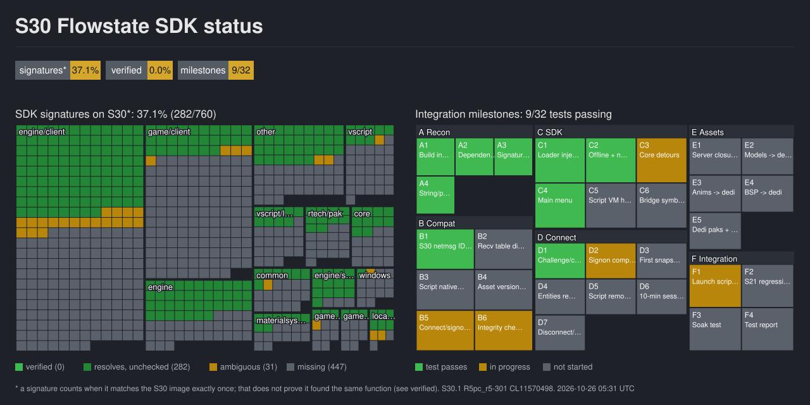

# S30 port

Port of the Flowstate SDK (`s21-r5sdk`, branch `s21-unify` @ `10077bb`) to the Apex Legends **S30.1** client
(`R5pc_r5-301_J28_CL11570498`), so that client can connect to the Season 3 dedicated server the way the S21
client does today. Local, offline use only.



| | |
|---|---|
| [docs/01-inventory.md](docs/01-inventory.md) | builds, binaries, SDK, tools, workspace |
| [docs/02-architecture.md](docs/02-architecture.md) | how the S21 client talks to the S3 dedi (injection, net bridge, tables, scripts, assets) |
| [docs/03-s21-vs-s30.md](docs/03-s21-vs-s30.md) | measured differences and the compatibility matrix |
| [docs/04-plan.md](docs/04-plan.md) | minimum change set, ranked risks, first experiment, phases and milestones |
| [PROGRESS.md](PROGRESS.md) | progress log, open issues, next action |
| [status/STATUS.md](status/STATUS.md) | table view of the status image |

## Tools

| script | does |
|---|---|
| `tools/pattern_census.py <src> <out.json> label=exe ...` | runs every SDK signature against each image and counts its matches |
| `tools/census_summary.py <census.json>` | splits the census by product and subsystem |
| `tools/strings_diff.py <a.exe> <b.exe> <outdir> a b` | string and RTTI diff by family (net messages, convars, launch params, natives) |
| `tools/pe_info.py <exe>...` | PE header facts and section entropy (packed or not) |
| `tools/make_status.py <census.json>` | regenerates `status/status.svg` and `status/STATUS.md` from the census, `verified.json` and `milestones.json` |

Regenerate the status after a census run:

```
py s30/tools/pattern_census.py src analysis/pattern_census.json s21dx11=<S21>/r5apex.exe s21dx12=<S21>/r5apex_dx12.exe s3ds=<S21>/r5apex_ds.exe s30=<S30>/r5apex_dx12.exe
py s30/tools/make_status.py analysis/pattern_census.json
```

"Resolves" means a signature matches the S30 image exactly once. A signature moves to `verified.json` only
after its S30 target has been checked by disassembly against the S21 original.
