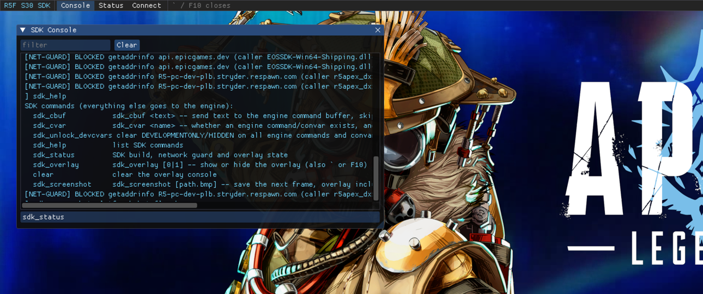

# 8. ImGui overlay and engine ConCommands on S30 (2026-10-26)

## Overlay (`src/core_s30/overlay_s30.cpp`, `overlay_panels_s30.cpp`)

S30 is DX12 only. The vtables of `IDXGISwapChain` and `ID3D12CommandQueue` are read from a throwaway
device/queue/swapchain (created in `SDK_Init`, not under the loader lock), and these shared methods are detoured:

| method | vtable slot |
|---|---|
| `IDXGISwapChain::Present` | 8 |
| `IDXGISwapChain::ResizeBuffers` | 13 |
| `IDXGISwapChain1::Present1` | 22 |
| `IDXGISwapChain3::ResizeBuffers1` | 39 |
| `ID3D12CommandQueue::ExecuteCommandLists` | 10 (captures the game's first DIRECT queue) |

On the first real present, ImGui 1.91.9b (in-tree `libimgui`, its DX12 and Win32 backends) initialises from the game's
swapchain: on this machine, window "Apex Legends" 3440×1440, 3 buffers, `R8G8B8A8_UNORM`. Font and style scale with
window height (1080p = 1.0). While the overlay is open, frames are recorded onto the current back buffer
(PRESENT → RENDER_TARGET → PRESENT) and submitted on the game queue right before the game's present, with
per-buffer allocators and a fence. A closed overlay costs nothing per frame. Back buffers are released and re-created
around `ResizeBuffers(1)`.

**Input.** The game window is subclassed. `` ` `` / F10 toggles the overlay; while it is open, ImGui gets keyboard and
mouse messages and the game does not (`WM_INPUT` still goes to `DefWindowProc`). The window thread and the render
thread share one ImGui lock. Opening the overlay focuses the console input.

**Panels.** A top bar, the SDK Console (all engine/script/SDK lines from a fixed 2,000-line ring, filter, Up/Down
history, Tab completion of SDK commands), Status, and Connect (native `connect`/`disconnect`, labelled as not yet
bridged to S3).

**Verified** (logs and screenshots in `tests\E4_overlay\`):
- 1,200+ overlay frames rendered with `GetDeviceRemovedReason() == S_OK`;
- the screenshot (`sdk_screenshot`, a back-buffer readback after the overlay draws) shows the overlay over the title
  screen;
- toggle by F10, typing `sdk_help` + Enter in the ImGui input runs it, Tab completes `sdk_st` → `sdk_status`.

Keys were posted to the window with `s30/tools/post_keys.ps1`, which goes through the same WndProc path as real keys.

## Engine ConCommands (`src/core_s30/concommand_s30.cpp`)

Layouts verified on S30.1:

| | S30.1 | S21 (client) |
|---|---|---|
| ConCommandBase | vtable, `m_pNext` +0x08, name +0x10, help +0x18, usage +0x20, flags +0x28, registered bit byte +0x2C — 0x30 bytes | `m_bRegistered` +0x10, name +0x18, … |
| ConCommand | supplemental +0x30/+0x38, callback +0x40, completion +0x48, callback kind byte +0x50 (2 = `fn(const CCommand&)`, 4 = interface) — 0x58 bytes | callbacks 0x10 later |
| CCommand | argc +0, argv0 size +8, args +0x10, argv[] +0x410 | same |
| `g_pCVar` | 0x3F83A60 → static `CCvar` 0x24D5260, vtable 0x1827BC0 | |
| ICvar slots | 8 AllocateDLLIdentifier, 9 RegisterConCommand, 13/14 FindCommandBase, 15/16 FindVar, 17/18 FindCommand | 8/9 same |

Sources:
- `ConVar_RegisterStatics` (0x5D8B50 vs S21 0x5766F0), the same code in both builds;
- `CCvar::RegisterConCommand` (0x5F6200): sets bit 0 of byte +0x2C, links via `m_pNext` into `cvar+80`, hashes the name
  at `cvar+88`;
- `ConCommand::Dispatch` (0x5D9200);
- the `connect` handler (0x2F0EF0) for `CCommand`.

client_s30 finds `g_pCVar` through `RegisterStatics`' own `mov rcx,[rip+…]`. It takes the ConCommand vtable and default
callbacks from the engine's static `echo` object (found by its name string), builds one 0x58-byte ConCommand per SDK
command (`FCVAR_RELEASE | FCVAR_CLIENTDLL`, callback kind 2), and registers it once
`FindCommandBase("echo")` succeeds (1.7 s into boot). One shared callback rebuilds the line from the `CCommand` and
runs the SDK dispatcher.

**Verified:** `sdk_cbuf sdk_status` sends the text straight to the engine command buffer, and the status was printed
on the engine's main thread, i.e. the engine dispatched our ConCommand. `sdk_cvar` shows engine flags
(`echo` is `DEVELOPMENTONLY`; `connect` is `RELEASE`).

## SDK commands

`sdk_help`, `sdk_status`, `sdk_overlay [0|1]`, `sdk_screenshot [path]`, `sdk_cvar <name>`, `sdk_unlock_devcvars`
(clears DEVELOPMENTONLY/HIDDEN on every command/convar, as S21 does under `-devsdk`), `sdk_cbuf <text>`, `clear`.

## Test tooling
- `platform/s30_commands.txt` drop file: lines are run as console input (polled every 500 ms).
- `s30/tools/post_keys.ps1`: posts keys and text to the test client's window.
- `-s30_overlay`: start with the overlay open. `-s30_selftest`: runs `sdk_status`, `echo` and `quit` after 20 s.
